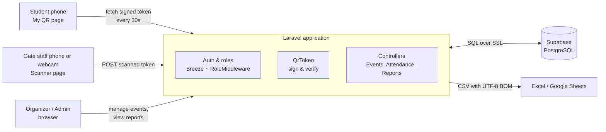
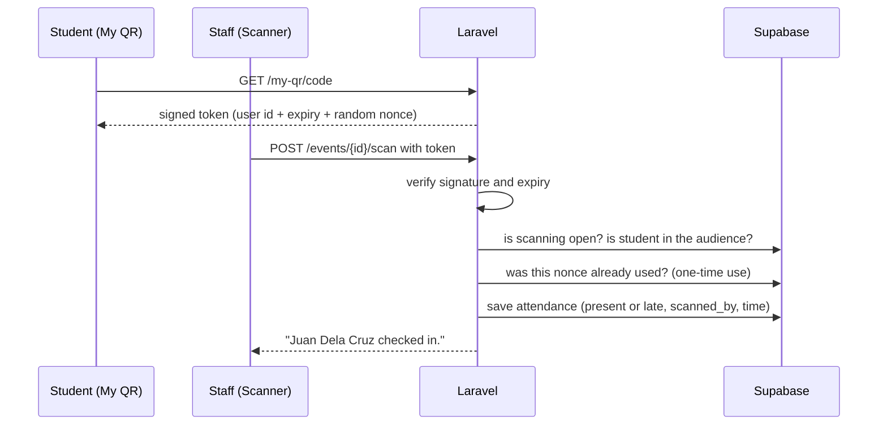
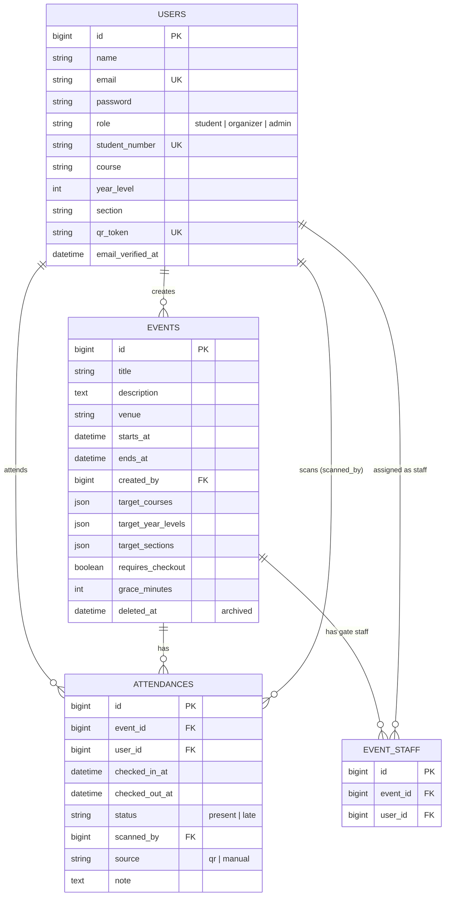

# CampusEvents

**QR-based attendance monitoring for school events at PUP Calauan Campus.**

CampusEvents replaces paper attendance sheets at seminars, assemblies, and org activities. Students show a personal QR code at the entrance, staff scan it with a phone or webcam, and the system records who was present, who was late, and who was absent.

> System Integration project · BSIT 3rd Year · Polytechnic University of the Philippines, Calauan Campus

---

## Team

| Member | Role in the project                   |
| ------ | ------------------------------------- |
| _Name_ | _e.g. Backend, scanning & attendance_ |
| _Name_ | _e.g. Reports & database_             |
| _Name_ | _e.g. UI/UX & front-end_              |

---

## Features

### Students

- Register with student number, course, year level, and section
- **My QR**: a personal code that changes every 30 seconds and works only once (screenshots can't be shared)
- **My Attendance**: on-time, late, and missed events
- Dashboard with upcoming events

### Organizers

- Create, edit, and archive events (venue, schedule, grace period, optional check-out)
- Choose the audience: specific courses, year levels, or sections
- Assign gate staff for each event
- Live attendees page: expected, present, late, and absent counts
- Manual check-in by student number, with a required reason that is logged
- CSV export for Excel (handles names like "Peña" and blocks spreadsheet formula tricks)

### Gate staff

- Assigned to one event; can only scan and view attendance for it
- Scanner shows a large green/red result with a beep and vibration

### Admins

- Everything organizers can do, for all events
- Manage users and change roles

---

## Tech stack

| Layer           | Technology                                                             |
| --------------- | ---------------------------------------------------------------------- |
| Backend         | Laravel (PHP), Laravel Breeze for login, role middleware               |
| Database        | Supabase PostgreSQL (SQLite for local demo and tests)                  |
| Front-end       | Blade, Tailwind CSS (PUP maroon & gold theme), Alpine.js               |
| QR              | `qrcode` (generator) and `html5-qrcode` (scanner), both in the browser |
| Quality         | PHPUnit tests, Laravel Pint and Prettier formatters                    |
| Version control | Git and GitHub (feature branches + pull requests)                      |

---

## System architecture



### How one check-in works



---

## Database (ERD)



`attendances` has a unique index on `(event_id, user_id)`, so a student can only have one record per event. Events are archived (soft deleted) instead of deleted, so attendance records are never lost.

---

## Setup (Windows, PowerShell)

Requirements: PHP 8.3+, Composer, Node.js 20+, Git.

```powershell
git clone https://github.com/aldredrecana/CampusEvents.git
cd CampusEvents
composer install
npm install
Copy-Item .env.example .env
php artisan key:generate
```

Open `.env` and fill in the Supabase connection (ask a team member privately for the password; it is never committed):

```
DB_CONNECTION=pgsql
DB_HOST=aws-0-ap-northeast-1.pooler.supabase.com
DB_PORT=5432
DB_DATABASE=postgres
DB_USERNAME=postgres.<project-ref>
DB_PASSWORD=<ask the team>
APP_TIMEZONE=Asia/Manila
QR_TTL_SECONDS=45
```

Then:

```powershell
php artisan migrate
php artisan db:seed      # optional: demo accounts and events
npm run dev              # terminal 1
php artisan serve        # terminal 2
```

Open http://localhost:8000

### Demo accounts (after `db:seed`)

| Role                      | Email               | Password |
| ------------------------- | ------------------- | -------- |
| Admin                     | admin@demo.test     | password |
| Organizer                 | organizer@demo.test | password |
| Student (also gate staff) | student1@demo.test  | password |

---

## Offline demo mode (no Supabase needed)

Use this if the internet or Supabase is down during a presentation. It uses a local SQLite file and does not touch the real database.

```powershell
New-Item database\database.sqlite -ItemType File -Force
php artisan migrate:fresh --seed --env=demo --force
php artisan serve --env=demo
```

`--env=demo` makes Laravel read `.env.demo` instead of `.env`.

---

## Tests and formatting

```powershell
php artisan test          # all tests
npm run format            # format PHP (Pint) + Blade/JS/CSS (Prettier)
npm run format:check      # check only
```

## Team workflow

1. Never push directly to `main`.
2. Create a branch: `git checkout -b feature/short-name`
3. Run `npm run format` and `php artisan test` before committing.
4. Push the branch and open a Pull Request. Another member reviews before merging.

---

## Future integration

- Import the official student masterlist from the registrar (CSV)
- REST API so other school systems can read event attendance
